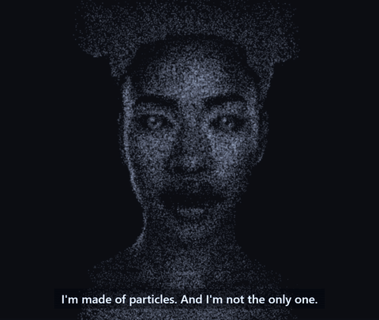

# Mnemosyne Avatar

A face made of particles that looks at you, listens, speaks and reacts.
It runs in the browser on three.js.

Avatar by [Mnemosyne OS](https://mnemosyne-os.io).



<!-- DRAFT: once posted, the full film (65 s, with sound) on YouTube: "Watch the film". -->
<!-- DRAFT: once the Hugging Face Space is public: "Talk to it in your browser". -->

The film above is made with this repository's `film` command line, one
designed voice per face. `film/examples/parade` is the same parade without
the voices, ready to render.

## What it does

- Her gaze follows your pointer. When you stay still, her eyes wander,
  then come back to you.
- She blinks, breathes, and turns her head a little while she listens.
- Her mouth follows a voice. Give it the loudness of each frame, and the
  spectrum if you have one.
- She plays expressions on demand: a smile, a wink, a laugh, surprise, a
  sigh, a sneeze, a grimace. Each one is drawn a little differently every
  time.
- She reacts to small things: a pointer that comes close to her face, a
  pause in her own speech, a thought that comes to her.
- She hears music. She nods on the beat, closes her eyes, and sometimes
  sings along under her breath.
- Left alone for five minutes, she falls asleep. A move wakes her.

The same engine draws a brain, twelve gallery faces (seven people and five
animals), four robots, a butterfly, a skull, a lion, and a particle orb for a voice button.

## Where it comes from

This is the face of [Mnemosyne OS](https://mnemosyne-os.io), an AI memory
that runs on your own machine, under your control. The face lives here. The
memory engine stays sealed inside the app.

## Install

The package is not on npm yet. Clone this repository and install it:

```bash
git clone https://github.com/Mnemosyne-OS/mnemosyne-avatar.git
cd mnemosyne-avatar
npm install
```

<!-- DRAFT: once published, `npm install @mnemosyne_os/avatar three`, and the imports below read '@mnemosyne_os/avatar'. -->

It ships TypeScript source. Your bundler compiles it: Vite, esbuild, or
webpack with a TypeScript loader.

## Quick start

```ts
import {
  AMBIENT_ALL, FORM_SECONDS, SHAPE_VIEWS, WOMAN,
  createBrainScene, createFaceAnimator, easeOutCubic, loadPortraitMap,
} from './src/index';

await loadPortraitMap('woman');
const canvas = document.querySelector('canvas')!;
const scene = createBrainScene(canvas, {
  shape: 'woman', portrait: WOMAN, pickTier: () => 'full', motion: true,
  colors: { ground: '#0d0b16', base: '#8f8bb8', glow: '#d9d2ff',
    engines: ['#56b6a9', '#e5b567', '#e88a95', '#7bc96f', '#b58ff7'] },
  width: innerWidth, height: innerHeight, pixelRatio: devicePixelRatio,
});
const face = createFaceAnimator();
face.wake(FORM_SECONDS);
const view = SHAPE_VIEWS.woman.front;

let last = performance.now() / 1000;
const t0 = last;
function frame() {
  const now = performance.now() / 1000;
  const faceFrame = face.step(now - last, {
    voice: 0, spectrum: null, lookGoal: { x: 0, y: 0 }, motion: true,
  });
  last = now;
  scene!.render({
    ry: view.ry, rx: view.rx, cam: view.cam, act: [0, 0, 0, 0, 0],
    form: easeOutCubic(Math.min(1, (now - t0) / FORM_SECONDS)),
    all: AMBIENT_ALL, face: faceFrame,
  }, now - t0);
  requestAnimationFrame(frame);
}
requestAnimationFrame(frame);
```

`createBrainScene` returns `null` when the browser has no WebGL. Check it
before you draw.

Call `face.express('wink')` to play an expression. `lookGoal` is where the
pointer is, from -1 to 1 on each axis, y up. `voice` is the loudness of her
voice, from 0 to 1.

## The example

`examples/basic` is a complete page: one face, the gaze on your pointer, an
expression on each click, and a button that moves the mouth.

```bash
npm install
npm run example
```

Then serve `examples/basic` with any static server and open it. For
example, `python -m http.server --directory examples/basic`.

## A video of the avatar

`film/` is a command line that turns a `film.json` (faces, lines, expressions,
gaze over time) into an MP4, on your machine. The voice takes come from
wherever you make them; the Mnemosyne OS MCP renders them with
`mnemosyne_voice_speak`. Read [film/README.md](film/README.md).

```bash
npm install
npm install playwright && npx playwright install chromium
npm run film -- doctor
npm run film -- probe film/examples/parade 4,12,46
npm run film -- render film/examples/parade
```

`film/examples/parade` is the parade at the top of this page, without the
voices: the brain, every face of the gallery cut into the next, and one ball
of light at the end. It needs ffmpeg with libx264 on your PATH.

## The main doors

| Import | What it gives |
|---|---|
| `createBrainScene` | The particle scene on a canvas: points, links, bloom, the morph between figures |
| `createFaceAnimator` | The life of a face, one `step` per frame, and `express(id)` |
| `loadPortraitMap` | Fetches a gallery face's density map when you wear it |
| `SHAPE_VIEWS`, `BRAIN_SHAPES`, `PORTRAIT_SHAPES` | The figures and how the camera frames them |
| `WOMAN`, `MAN`, `robotFigure` | Ready figures with a rig: eyes, lids, mouth, brows |
| `ROBOT_IDS`, `robotFigure` | The four robots, drawn in code: `shape: 'woman', portrait: robotFigure('robot-pixel')` |
| `createBeatTracker` | The tempo of the music, from an analyser's spectrum |
| `makeOrbParticles`, `orbParticleFrame` | The particle orb, as SVG paths |

Each module is also its own import, for example `./src/faceAnimator`.

## Contributing

New expressions, scenarios, gaze reactions and faces are welcome. Read
[CONTRIBUTING.md](CONTRIBUTING.md) for a template of each.

Comments in the source that cite "doc NNN" point to the design notes of
Mnemosyne OS, which are not public. The code they describe is all here.

## License

This repository is source-available under the
[Business Source License 1.1](LICENSE).

- Free in production for a person or a company under 1 million US dollars
  of annual revenue, affiliates included.
- The condition: show the credit "Avatar by Mnemosyne OS", with a link to
  https://mnemosyne-os.io, on the screen where the avatar appears or on your
  "About" page.
- Above that revenue, a commercial license is available from XPACEGEMS LLC.
- Four years after each version is published, that version becomes
  available under the Apache License 2.0.

<!-- DRAFT: the license text is pending review by counsel. -->

Copyright (c) 2026 XPACEGEMS LLC.
