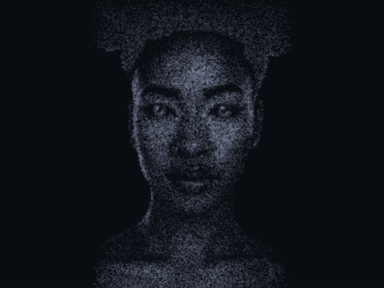
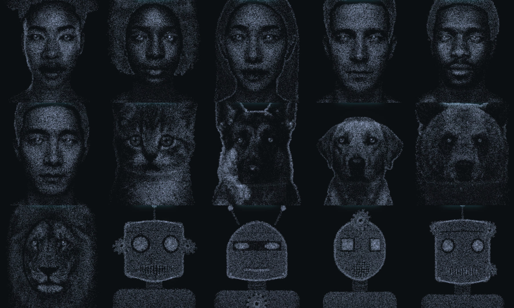

# Mnemosyne Avatar

A face made of particles. It looks at you, blinks, breathes, listens and
speaks. It runs in the browser, on three.js.



**[Watch the film](https://www.youtube.com/watch?v=AnN1g1owWtg)** ·
**[Talk to it on Hugging Face](https://huggingface.co/spaces/Mnemosyne-OS/mnemosyne-avatar)** ·
**[Mnemosyne OS](https://mnemosyne-os.io)**

<!-- The film is the Almost Human Short. -->

Avatar by [Mnemosyne OS](https://mnemosyne-os.io).

## Almost human, on purpose

Irina is the face of Mnemosyne OS. For the first three seconds of the film,
she does not blink and her eyes do not move. Only her mouth speaks. Then she
says the same line again, with the same sound, on her living face.

That shiver is the uncanny valley. A face is the blink, the glance, the half
second before a smile. This engine draws all of them, and it can switch them
off for three seconds to prove it.

The film is 38 seconds long. This repository's `film` command line made it
frame by frame, on one laptop. Its `film.json` and its voice takes are in
[film/examples/almost-human](film/examples/almost-human), ready to render.

## One engine, every face



Twelve faces come from photos turned into density maps: seven people and
five animals. Four robots are drawn in code, and so are a brain, a
butterfly, a skull, a lion and a particle orb for a voice button.

## What it does

- Her gaze follows your pointer. When you stay still, her eyes wander,
  then come back to you.
- She blinks, breathes, and turns her head a little while she listens.
- Her mouth follows a voice. Give it the loudness of each frame, and the
  spectrum if you have one.
- She plays expressions on demand: a smile, a wink, a laugh, surprise, a
  sigh, a sneeze, a grimace. Each one is drawn a little differently every
  time.
- She reacts to small things: a pointer that comes close to her face, a
  pause in her own speech, a thought that comes to her.
- She hears music. She nods on the beat, closes her eyes, and sometimes
  sings along under her breath.
- Left alone for five minutes, she falls asleep. A move wakes her.

## Talk to it

The [Hugging Face Space](https://huggingface.co/spaces/Mnemosyne-OS/mnemosyne-avatar)
runs this avatar with three models, all in your browser, on your own
graphics card:

- Whisper base hears you while the Speak button is lit.
- LFM3-1.7B by Liquid AI, or SmolLM3-3B by Hugging Face, answers on WebGPU.
- Kokoro-82M speaks, and its sound moves her mouth.

It speaks English, French, Spanish and Brazilian Portuguese. It needs a
recent Chrome or Edge with WebGPU.

## Make a film

`film/` turns a `film.json` into an MP4 on your machine: the faces, the
lines, the expressions and the gaze over time. The voice takes come from
any voice engine you like.

The opening of Almost Human, cut from its `film.json`:

```json
{
  "total": 37.796,
  "shots": [{ "shape": "woman", "at": 0, "until": 11, "formed": true }],
  "still": [{ "at": 0, "end": 2.664, "shape": "woman" }],
  "lines": [{ "id": "almost-dead", "at": 0.35, "end": 2.314, "text": "Hi. I'm almost human.", "shape": "woman" }],
  "cues": [{ "id": "almost-dead", "at": 0.35 }],
  "moves": [{ "at": 2.714, "id": "smile", "shape": "woman" }]
}
```

`still` freezes the face inside its window. `formed` brings a face in whole,
eyes open. A cue lays the take `voice/en/trim/<id>.wav` at its time, and
the `voice` command turns the takes into the mouth's moves. A title can
slide to the centre with `moveTo`. Every key is in
[film/README.md](film/README.md).

Render the whole film:

```bash
npm install
npm install playwright && npx playwright install chromium
npm run film -- doctor
npm run film -- voice film/examples/almost-human
npm run film -- render film/examples/almost-human
npm run film -- score film/examples/almost-human
npm run film -- audio film/examples/almost-human
npm run film -- mux film/examples/almost-human --name almost-human
```

It needs ffmpeg with libx264 on your PATH. `film/examples/parade` is a
second example, without voices: the brain, every face of the gallery cut
into the next, and one ball of light at the end.

With Mnemosyne OS installed, its MCP server makes the voice takes with
`mnemosyne_voice_speak`.

## Install

The package is not on npm yet. Clone this repository and install it:

```bash
git clone https://github.com/Mnemosyne-OS/mnemosyne-avatar.git
cd mnemosyne-avatar
npm install
```

<!-- DRAFT: once published, `npm install @mnemosyne_os/avatar three`, and the imports below read '@mnemosyne_os/avatar'. -->

It ships TypeScript source. Your bundler compiles it: Vite, esbuild, or
webpack with a TypeScript loader.

## Quick start

```ts
import {
  AMBIENT_ALL, FORM_SECONDS, SHAPE_VIEWS, WOMAN,
  createBrainScene, createFaceAnimator, easeOutCubic, loadPortraitMap,
} from './src/index';

await loadPortraitMap('woman');
const canvas = document.querySelector('canvas')!;
const scene = createBrainScene(canvas, {
  shape: 'woman', portrait: WOMAN, pickTier: () => 'full', motion: true,
  colors: { ground: '#0d0b16', base: '#8f8bb8', glow: '#d9d2ff',
    engines: ['#56b6a9', '#e5b567', '#e88a95', '#7bc96f', '#b58ff7'] },
  width: innerWidth, height: innerHeight, pixelRatio: devicePixelRatio,
});
if (!scene) throw new Error('This browser has no WebGL');
const face = createFaceAnimator();
face.wake(FORM_SECONDS);
const view = SHAPE_VIEWS.woman.front;

let last = performance.now() / 1000;
const t0 = last;
function frame() {
  const now = performance.now() / 1000;
  const faceFrame = face.step(now - last, {
    voice: 0, spectrum: null, lookGoal: { x: 0, y: 0 }, motion: true,
  });
  last = now;
  scene!.render({
    ry: view.ry, rx: view.rx, cam: view.cam, act: [0, 0, 0, 0, 0],
    form: easeOutCubic(Math.min(1, (now - t0) / FORM_SECONDS)),
    all: AMBIENT_ALL, face: faceFrame,
  }, now - t0);
  requestAnimationFrame(frame);
}
requestAnimationFrame(frame);
```

`createBrainScene` returns `null` when the browser has no WebGL, so the
snippet checks it before it draws.

Call `face.express('wink')` to play an expression. `lookGoal` is where the
pointer is, from -1 to 1 on each axis, y up. `voice` is the loudness of her
voice, from 0 to 1. `motion: false` freezes her: no blink, no glance, no
gesture, and the mouth still speaks.

## The example

`examples/basic` is a complete page: one face, the gaze on your pointer, an
expression on each click, and a button that moves the mouth.

```bash
npm install
npm run example
```

Then serve `examples/basic` with any static server and open it. For
example, `python -m http.server --directory examples/basic`.

## The main doors

| Import | What it gives |
|---|---|
| `createBrainScene` | The particle scene on a canvas: points, links, bloom, the morph between figures |
| `createFaceAnimator` | The life of a face, one `step` per frame, and `express(id)` |
| `loadPortraitMap` | Fetches a gallery face's density map when you wear it |
| `SHAPE_VIEWS`, `BRAIN_SHAPES`, `PORTRAIT_SHAPES` | The figures and how the camera frames them |
| `WOMAN`, `MAN` | Ready figures with a rig: eyes, lids, mouth, brows |
| `ROBOT_IDS`, `robotFigure` | The four robots, drawn in code: `shape: 'woman', portrait: robotFigure('robot-pixel')` |
| `createBeatTracker` | The tempo of the music, from an analyser's spectrum |
| `makeOrbParticles`, `orbParticleFrame` | The particle orb, as SVG paths |

Each module is also its own import, for example `./src/faceAnimator`.

## Where it comes from

This is the face of [Mnemosyne OS](https://mnemosyne-os.io), an AI memory
that runs on your own machine, under your control. The face lives here. The
memory engine stays sealed inside the app.

## Contributing

New expressions, scenarios, gaze reactions and faces are welcome. Read
[CONTRIBUTING.md](CONTRIBUTING.md) for a template of each.

Comments in the source that cite "doc NNN" point to the design notes of
Mnemosyne OS, which are not public. The code they describe is all here.

## License

Mnemosyne Avatar is open source, for personal and commercial use.

- The code is under the [Apache License 2.0](LICENSE).
- The faces are under [CC BY 4.0](LICENSE-FACES). The [NOTICE](NOTICE) file
  lists them: the twelve `src/*Portrait.ts` files and the two images in
  `docs/`.
- If you use a face, show the credit "Avatar by Mnemosyne OS", with a link to
  https://mnemosyne-os.io, on the screen where the avatar appears or on your
  "About" page.

Copyright (c) 2026 XPACEGEMS LLC.
